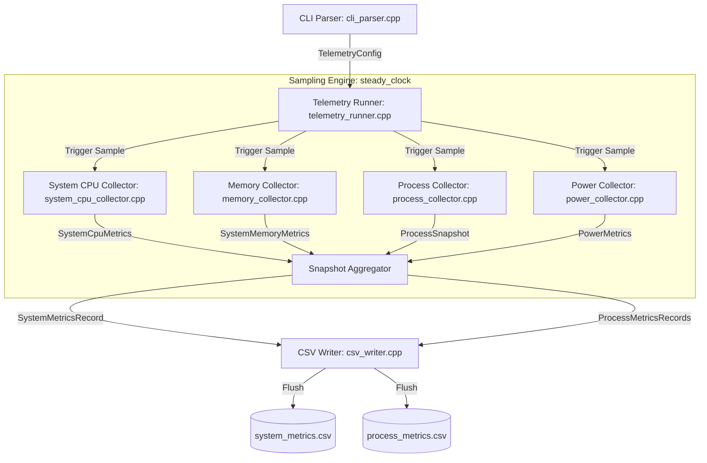

# Architecture & System Design

The **Windows Device Telemetry Monitor** is an enterprise-grade, native C++20 diagnostics and device telemetry application targeting **Windows 10 and Windows 11 (x64)**. It is architected specifically for low-overhead, deterministic periodic telemetry collection, strict memory safety, and robust error handling under non-elevated user privileges.

---

## 1. Architectural Overview

The application follows an asynchronous, decoupled pipeline model separating CLI parsing, orchestrating the periodic sampling loop, executing isolated subsystem collectors, and writing RFC 4180 compliant CSV output.

---

## 2. Core Subsystems & Responsibilities

### 2.1. CLI Parsing (`common/cli_parser.h`, `src/common/cli_parser.cpp`)
- Evaluates command-line options (`--interval-ms`, `--duration-seconds`, `--output-dir`, `--top-processes`, `--include-processes`, `--help`, `--version`).
- Enforces strict validation boundaries:
  - Sampling interval: `[250, 60000]` milliseconds.
  - Duration: positive non-zero, capped to 1 year to prevent integer overflow.
  - Top processes: bounded to `[0, 1000]` to eliminate unbounded heap allocations.
- Rejects malformed arguments, non-numeric tokens, and unknown options with descriptive diagnostics.

### 2.2. Sampling Engine (`telemetry/telemetry_runner.h`, `src/telemetry/telemetry_runner.cpp`)
- **Monotonic Scheduling**: Employs `std::chrono::steady_clock` to schedule wakeups at fixed intervals (`start_time + sample_index * interval`). This eliminates accumulated scheduling drift that plagues naive `sleep(interval)` loops.
- **Drift-Free Interval Sleep with Cancellation**: Samples are scheduled against absolute monotonic deadlines while checking an `std::atomic<bool>` cancellation token in 50 ms slices, providing immediate responsiveness to termination signals.
- **Signal Handling**: Installs native Windows console control handlers (`SetConsoleCtrlHandler`) to intercept `CTRL_C_EVENT`, `CTRL_BREAK_EVENT`, and `CTRL_CLOSE_EVENT`, ensuring all pending telemetry records are flushed and file handles are safely closed before termination.

### 2.3. Native Metric Collectors
Each collector is self-contained and isolated from other collection mechanisms:

1. **System CPU Collector (`collectors/system_cpu_collector.h`, `src/collectors/system_cpu_collector.cpp`)**:
   - Queries `GetSystemTimes` for cumulative kernel, user, and idle ticks.
   - Converts 64-bit `FILETIME` structures safely without 32-bit truncation.
   - Calculates CPU utilization from consecutive deltas.
   - Handles first-sample initialization, zero-time deltas, and multi-core clock skew cleanly.

2. **Memory Collector (`collectors/memory_collector.h`, `src/collectors/memory_collector.cpp`)**:
   - Queries `GlobalMemoryStatusEx`.
   - Collects total and available physical memory, used physical bytes, computed physical percentage, total and available virtual memory, and the OS memory load index.
   - Strictly separates physical and virtual memory metrics.

3. **Process Collector (`collectors/process_collector.h`, `src/collectors/process_collector.cpp`)**:
   - Enumerates process IDs using `EnumProcesses` with dynamic buffer scaling.
   - Opens process handles using RAII wrappers (`WindowsHandle`) with least-privilege access rights (`PROCESS_QUERY_LIMITED_INFORMATION | PROCESS_VM_READ`, falling back to `PROCESS_QUERY_LIMITED_INFORMATION`).
   - Retrieves full process image path via `QueryFullProcessImageNameW` and converts Unicode names safely to UTF-8.
   - Queries working set size and page fault counts via `GetProcessMemoryInfo`.
   - Computes per-process CPU percentage normalized across total logical processor capacity using `GetProcessTimes`.
   - Tracks process creation timestamps alongside PID to protect against PID reuse anomalies.
   - Maintains an accurate tally of skipped inaccessible processes.

4. **Power & Battery Collector (`collectors/power_collector.h`, `src/collectors/power_collector.cpp`)**:
   - Queries `GetSystemPowerStatus`.
   - Decodes AC line status, battery status flags, battery charge percentage, and estimated remaining run time.
   - Treats unknown sentinel values (`255` for percentage, `-1` for lifetime) as `std::nullopt` (empty CSV cells) rather than misleading zeros.
   - Operates gracefully on systems without batteries (desktops, servers, virtual machines).

### 2.4. CSV Persistence Layer (`output/csv_writer.h`, `src/output/csv_writer.cpp`)
- Produces two distinct CSV output streams: `system_metrics.csv` and `process_metrics.csv`.
- Adheres strictly to RFC 4180:
  - Quotes fields containing commas, double quotes, or newlines.
  - Escapes internal double quotes by doubling them (`""`).
  - Represents unavailable metrics as empty strings (`,,`).
  - Emits UTF-8 character encoding.
- Performs immediate per-sample flushing to prevent data loss on unexpected process termination.

---

## 3. Resource Management & Handle Hygiene (RAII)

Raw Windows handles (`HANDLE`) must never be managed manually in modern systems code. The project implements `common::WindowsHandle`:
- Owns a single `HANDLE`.
- Automatically calls `CloseHandle` in its destructor when the handle is valid (`handle != nullptr && handle != INVALID_HANDLE_VALUE`).
- Enforces move-only semantics (copy constructor and copy assignment are deleted).
- Eliminates handle leaks across exceptions, early returns, or access-denied error paths.

---

## 4. Privilege Model & Access Boundaries

Windows Device Telemetry Monitor is designed to run under standard user privileges without administrative elevation:
- **Least Privilege Requests**: Process opening requests only `PROCESS_QUERY_LIMITED_INFORMATION` and optionally `PROCESS_VM_READ`.
- **System & Protected Processes**: Operating system processes (such as PID 4 System, `csrss.exe`, `lsass.exe`) and Anti-Cheat / Protected Processes (PPL) deny handle creation to non-admin tokens.
- **Graceful Skipping**: When `OpenProcess` fails with `ERROR_ACCESS_DENIED`, the collector increments `skipped_process_count` and continues safely without crashing or halting collection.
